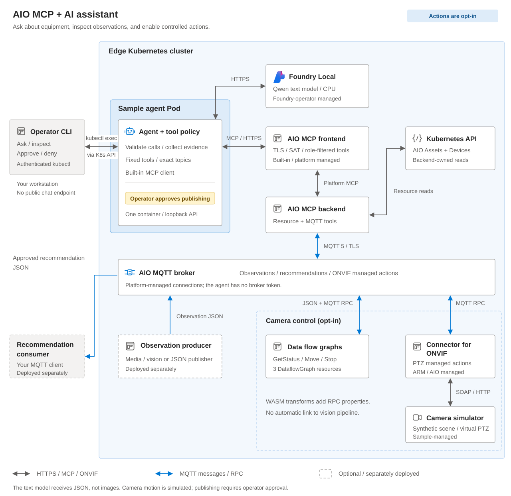

# AIO MCP and AI: edge operations assistant

Ask natural-language questions about equipment configured in Azure IoT
Operations (AIO) and the observations published by your edge applications.
This sample runs an assistant on the edge cluster, using a Foundry
Local text model and AIO's built-in **Model Context Protocol (MCP)** frontend.
The assistant is an MCP client; it does not deploy custom MCP servers.

The assistant can retrieve Asset and Device configuration, read recent JSON
messages from approved MQTT topics, and explain the results. Each response
includes the tool calls and data behind the answer so that an operator can
inspect the evidence.

Start with read-only questions, then optionally enable two bounded actions:
pan an ONVIF camera simulator, and publish a recommendation **only after an
operator approves it**. Both actions are disabled in the default configuration.

**Use the sample:** [Scenario](#scenario) | [Architecture](#architecture) |
[Prerequisites](#prerequisites) | [Build](#build-and-test-locally) |
[Configure](#configure-the-instance) | [Deploy](#deploy-the-scenario) |
[Run](#run-and-observe) | [Validate](#validate-the-integrations) |
[Camera actions](docs/camera-actions.md) |
[Clean up](#stop-and-clean-up).

> [!IMPORTANT]
> **Compatible preview environment required.** Foundry Local here is the
> Kubernetes operator with `ModelDeployment` and generative-model support, not
> the desktop application. Confirm the [prerequisites](#prerequisites) before
> deploying. The built-in AIO MCP frontend/backend must already be enabled,
> with TLS, service-account-token authentication, and the required tools.
> Upgrading an earlier custom-MCP deployment? Follow the
> [migration steps](docs/operations.md#migrate-from-the-custom-mcp-version).

This is an evaluation sample, not an autonomous monitoring or safety system.
Review the [limitations](#limitations) before using its answers operationally.

## Scenario

A camera overlooks a workcell. A person-detection pipeline publishes a result
for each successfully processed image, while AIO stores the camera's Asset and Device
configuration. An operator needs to answer three different questions: what is
configured, what the detector recently reported, and whether any processing
errors were observed.

This sample adds a conversational interface to those existing data sources:

| Operator request | What happens |
| --- | --- |
| Which assets are configured, and which devices do they reference? | Built-in resource tools list names and descriptions; named reads retrieve configuration. |
| Which streams or datasets are configured on this asset? | The named resource's configuration, with sensitive fields redacted. |
| What do recent person-detection messages report? | A bounded sample of JSON messages from the configured results topic. |
| Were any processing errors reported during the sample window? | Messages from the configured error topic, or an explicit empty result. |
| Pan the simulated camera right for two seconds. | Sends bounded PTZ commands through the MQTT broker and connector for ONVIF, explicitly stops, and checks the returned position and `IDLE` state. Requires camera enablement. |
| Prepare a recommendation for an operator to review. | Returns the proposed JSON and an expiring approval ID. Only a separate operator approval can publish it to the configured MQTT topic. Requires publishing enablement. |

Use the [edge predictive inference sample](../edge-predictive-inference/README.md)
to supply the camera observations. Its media connector, data flow graph,
inference connector, and YOLOX-Nano model produce frame-level person detections.
The assistant reads that **result JSON**; it does not process images or run the
person-detection model.

You can start with resource questions without deploying the camera pipeline.
For observation questions, connect the companion pipeline or another authorized
JSON publisher. The assistant does not generate sample observations when a
producer is unavailable.

### What you will deploy and run

By completing this scenario, you will deploy the assistant, reuse the existing
AIO MCP frontend/backend, deploy a dedicated text model, and run questions against your own
resource metadata and MQTT observations. You will also call the tools directly
to compare their data with the model's answer.

The seven-tool catalog includes four resource reads, a telemetry read,
`camera-pan`, and `recommendation-publish`. The host rejects disabled
actions; enabling them does not grant arbitrary topics, camera addresses, or
shell access. Resource queries remain read-only.

The optional [camera tutorial](docs/camera-actions.md) adds a software camera,
an AIO connector template for ONVIF if one is needed, a registered Device and
PTZ control Asset, and three **data flow graphs for camera control**. Each graph
runs a custom WebAssembly (WASM) transform. These transforms add the
MQTT RPC properties that the built-in publish tool cannot set; they are not MCP
servers. No physical camera is required for that tutorial. There is
no web chat interface, continuous monitoring, historical store, model training,
automatic alerting, or recommendation-execution workflow.

## Architecture



Dashed outlines mark optional integrations. Observation producers and recommendation
consumers are deployed separately; the camera simulator is not automatically
connected to the observation pipeline.

| Component | Role in the scenario | Deployment |
| --- | --- | --- |
| Operator CLI | Sends questions/tool requests and explicitly approves or denies pending recommendations. | Runs on your workstation using authenticated `kubectl exec`; no public chat endpoint. |
| Assistant agent | Checks model-selected calls, collects evidence, and holds recommendations for approval. | `edge-assistant` Deployment. |
| Built-in AIO MCP frontend | Authenticates the agent and exposes its role-filtered tool catalog. | Existing platform Service `aio-mcp-frontend`, HTTPS `/mcp`; not deployed by this sample. |
| Built-in AIO MCP backend | Reads AIO resources, samples MQTT messages, and publishes JSON. | Existing platform-managed backend; owns Kubernetes resource access and broker connections. |
| Foundry Local text model | Selects tools and generates an answer using their results. | Dedicated generative `ModelDeployment` managed by the existing Foundry operator. |
| AIO broker and observation producer | Supply the messages to interpret. | Existing broker; companion predictive-inference pipeline or another separately deployed producer. |
| Connector for ONVIF and camera simulator, optional | Translate managed-action MQTT requests to ONVIF SOAP; the simulator changes its image viewport and PTZ state. | Connector managed by AIO; sample-owned simulator Deployment and Service. |
| Camera-control data flow graphs, optional | Run custom WASM transforms that add MQTT response/correlation properties using the AIO SDK and return the actual ONVIF managed-action result. | Three independently deployed `DataflowGraph` resources: GetStatus, ContinuousMove, and Stop. |

### Request and data flow

1. You run `manage.py ask` from your workstation. The helper uses the explicit
   Kubernetes context in your configuration to send the question to the agent.
2. The agent sends the question and available tool definitions to Foundry Local.
   The model requests a resource read or a telemetry sample.
3. The host maps the selected application tool to the built-in frontend.
   The platform backend reads AIO resources or samples the configured MQTT topics.
4. The agent returns the tool result to the text model, which generates its
   answer. Additional permitted reads can occur before the answer is returned.
5. The CLI prints both the answer and `toolActivity`, containing the actual
   arguments, resources, and messages used for that question.

Agent connections to MCP and Foundry use TLS and projected service-account tokens.
Frontend roles control the available built-in tools; the backend's platform
permissions control resource and broker access. The application adds a fixed
tool allowlist, exact topic bindings, and an approval gate. Model output is not
an authorization boundary, and these application restrictions do not narrow
the underlying platform identity's permissions.

The sample's Kubernetes manifests create the assistant workloads, identities,
and text-model request. They do not install AIO or Foundry Local, and do not
deploy or change the camera pipeline. See
[architecture and contracts](docs/architecture.md) for detailed permissions,
data formats, and component boundaries.

For an enabled camera action, the agent publishes JSON through
`aio_mqtt_publish` to the camera-control data flow graphs. Their WASM transforms
invoke the connector for ONVIF with proper MQTT RPC properties; the agent samples
correlated results through `aio_mq_messages`. It checks initial status, attempts
`ContinuousMove`, explicitly stops, and verifies final `IDLE` and pan position.
It never sends SOAP directly to the camera.

For a recommendation, the question ends with `approval_required`; nothing is
published yet. A separate `manage.py approve` command consumes that approval
and publishes the reviewed payload. A denial, expired approval, or disabled
publisher sends no recommendation. The text model cannot approve its own request.

## Prerequisites

| Requirement | Expected capability |
| --- | --- |
| Development machine | Linux or WSL, Python 3.10+, Docker with Linux/amd64 image builds, and `kubectl`. |
| AIO installation | Built-in MCP frontend/backend enabled; the frontend Service exposes HTTPS port 443 and accepts projected SATs. Its catalog must provide `aio_list_assets`, `aio_get_asset`, `aio_list_devices`, `aio_get_device`, and `aio_mq_messages`; actions also require `aio_mqtt_publish`. |
| Foundry Local operator | `foundrylocal.azure.com/v1` `ModelDeployment`, internal HTTPS endpoints, SAT authorization, and the generative `onnx-genai` runtime for the selected compute. |
| Model catalog | Access to `qwen3.5-2b-text-generic-cpu:1`, the CPU text model used by the example configuration, and acceptance of its terms. The sample does not redistribute model weights. |
| TLS and networking | Public AIO frontend and Foundry CA bundles; standard `cluster.local` DNS; a CNI enforcing NetworkPolicy. Platform certificates are reused; the sample creates no MCP server certificate. |
| Permissions | An installer able to create sample resources and the scoped Foundry model-reader binding; a platform owner to approve MCP role assignments and backend access. |
| Container registry | A registry you can push to, and pull access for the sample namespace. |
| Observation producer | Required for MQTT questions: a running publisher of JSON objects on the selected topics. The companion person-detection pipeline is one supported input scenario. |

The default CPU model requests **4 CPUs and 4 GiB**, with limits of 8 CPUs and 8 GiB,
in addition to AIO and the assistant services. A GPU is **not required** for this
configuration. The selected node must have at least four allocatable CPUs
available; a four-vCPU VM normally has less after platform reservations.
Initial model download and CPU generation can take time. The helper does not
provision nodes or install platform components.

The installer needs broader permissions than an operator. An operator needs
access to get the sample Deployment, find its Pods, and create `pods/exec` in the
sample namespace. Exec is privileged container access, not an end-user chat
authorization mechanism. Do not grant it to untrusted users.

For platform setup and connecting existing resources, see
[connect the actual components](docs/operations.md#connect-the-actual-components).

## Build and test locally

From the repository root:

```bash
cd samples/aio-mcp-ai-assistant
python3 -m venv .venv
source .venv/bin/activate
python -m pip install -e '.[dev]'

python -m pytest
ruff check src tests manage.py
ruff format --check src tests manage.py
```

The local tests use [mocks and fixtures](#real-components-mocks-and-replay-inputs);
they do not contact a cluster, subscribe to MQTT, or run the text model.
Continue with deployment to exercise the real integrations.

## Configure the instance

```bash
cp config.example.json config.json
```

Edit `config.json` before running the next commands. Replace every
`REPLACE_WITH_` value:

| Setting | How to choose it |
| --- | --- |
| `kubeContext` | An explicit context from `kubectl config get-contexts`. Helpers never switch the global context. |
| `namespace` | A new, dedicated namespace. The helper creates it and refuses to adopt unrelated existing resources. |
| `aioNamespace` | The namespace containing the built-in MCP frontend and its public CA ConfigMap. Resource visibility is controlled by the platform backend, not a custom reader Role. |
| `image` | Your registry/repository and a new explicit version tag. `latest` and unqualified image names are rejected. |
| `imagePullSecret` | An existing or planned registry pull secret in the sample namespace. Use `""` only when no secret is needed. |
| `mcp.tokenAudience` | The built-in frontend's inbound SAT audience, normally `aio-mcp-frontend`. This is not the backend's audience or the broker's `aio-internal` audience. |
| `mcp.caConfigMap` / `caKey` | The public CA bundle trusting the built-in frontend in `aioNamespace`. Confirm the actual key, such as `trust-bundle.pem` or `ca.crt`. |
| `foundry.namespace` | The existing Foundry operator/model namespace. |
| `foundry.deploymentName` | A new, dedicated model name; the helper will not overwrite an unrelated deployment. |
| `foundry.catalogName` / `catalogVersion` | The model's installed catalog name and version. Keep the example's Qwen CPU entry for the documented CPU configuration. |
| `foundry.assetId` | Required by Foundry 2.x: the catalog's exact versioned `azureml://registries/.../models/.../versions/...` ID, matching `catalogName` and `catalogVersion`. Omit only for older operators that accept `model.catalog`. |
| `foundry.compute` | `cpu` by default; `gpu` requires a compatible GPU model, provisioned GPU capacity, and `nodePool`. |
| `foundry.nodePool` | Optional existing AKS node-pool name; required for GPU. Use it to place the model on dedicated capacity. It does not create or modify the pool. |
| `foundry.tokenAudience` | The audience accepted by your installed Foundry gateway. Obtain it from the platform owner; do not guess or change the shared operator to match this sample. |
| `foundry.caConfigMap` / `caKey` | The public CA bundle for the model's internal HTTPS endpoint, in the configured Foundry namespace. |
| `sources` | One to eight distinct, exact JSON topics. Each has a `stage`, optional `machineId`, and meaningful `description`. Stage/machine bindings must be unique; wildcards are not allowed. |
| `camera` | After [camera setup](docs/camera-actions.md), set `enabled: true`, the control `assetName`, discovered `profileToken`, and an instance-specific `topicPrefix`. |
| `cameraGraphs` | Registry settings for the camera-control data flow graphs' WASM modules and graph definitions: artifact registry, existing `registryEndpointName`, and explicit `artifactVersion`. Required for camera checks and movement. Configuring it adds the frontend `Admin` role even while movement is disabled, because GetStatus requests use the publish tool. |
| `recommendations` | Disabled by default. Set `enabled: true` and a dedicated exact `topic` only when an operator and intended consumer are ready. See [recommendation publishing](#review-and-publish-a-recommendation). |
| `simulator` | Omit for read-only use or real equipment. For the camera tutorial, add an `image` with your explicitly versioned simulator image. |

### Select the text model

The example selects `qwen3.5-2b-text-generic-cpu`, version `1`, with `compute`
set to `cpu`. For Foundry 2.x, add the following property **inside the existing
`foundry` object**, after confirming the entry in your installed catalog:

```json
{
  "assetId": "azureml://registries/azureml/models/qwen3.5-2b-text-generic-cpu/versions/1"
}
```

Use the gateway's actual token audience and public CA bundle. Do not change
shared platform authentication settings to match an example value.
GPU configuration is optional and requires a matching GPU catalog variant,
an existing GPU node pool, and installed drivers; see
[model integration](docs/operations.md#connect-the-agent-to-a-real-foundry-model).

### Connect the observation producer

For camera observations, deploy the companion
[person-detection pipeline](../edge-predictive-inference/README.md#deployment-and-operations)
with an authorized RTSP camera. Use its
[result reader](../edge-predictive-inference/README.md#run-and-observe-the-pipeline)
to confirm that it publishes observations before asking the assistant about them.

The default `sources` configuration connects these topics:

| Configuration label | `stage` | `machineId` | MQTT topic |
| --- | --- | --- | --- |
| `person-detections` | `inference` | `person` | `edge/predictive-inference/person/results` |
| `person-errors` | `errors` | `person` | `edge/predictive-inference/person/errors` |

If you changed the producer's topic prefix, update both topics. The tool uses
`stage` and `machine_id` to select these bindings; the configuration property is
spelled `machineId`. Configuration labels such as `person-detections` are not
tool arguments.

For another producer, use its exact JSON topics and describe what each payload
means in `description`. Do not select JPEGs, raw tensors, or sensitive telemetry:
selected payloads are sent to the text model and returned to the caller.
Resource reads also require care: sensitive-key redaction is not a complete
secret filter. Use secret references rather than credentials in resource text.

If you are starting with resource questions only, the producer can remain
undeployed. Leave valid source settings in the configuration, but do not
interpret an empty observation topic as a working pipeline.

## Deploy the scenario

Run the following steps in order from the sample directory with `.venv`
active and the populated `config.json` available. All cluster commands use
`kubeContext`; the helper does not change your global Kubernetes context.

### Build and publish the image

```bash
python manage.py render config.json
python manage.py build config.json
```

`render` validates configuration and writes reviewable YAML plus
`mcp-access.json` under `.generated/`, without contacting the cluster. The JSON
is a review inventory, **not an authorization policy**. Optional graph artifacts
are rendered when `cameraGraphs` is configured. `build` creates the Linux/amd64
agent image identified by `image`; there are no custom MCP server containers.

Authenticate Docker to your registry using your organization's approved flow,
then publish:

```bash
python manage.py push config.json
```

Keep `config.json`, generated files, and credentials out of commits. The sample
ignores local configuration and build output.

### Authorize the built-in frontend

Have the platform owner review `.generated/mcp-access.json` and the generated
ServiceAccount before `prepare`. The default annotation is:

```yaml
aio-mcp-auth/roles: '["Reader","DataReader"]'
```

Configuring camera-control data flow graphs or enabling recommendation publication adds
`Admin`, matching the built-in catalog where `aio_mqtt_publish` is an Admin tool.
**Admin exposes more capabilities than this sample uses.** The model receives
only the seven fixed application tools, not raw publish/topic tools or the full
Admin catalog. Restrict who can annotate ServiceAccounts, read projected tokens,
or exec into the agent.

The agent has no broker token or direct MQTT connection. The built-in backend
uses its own platform-managed identity. Its broker permissions must allow the
topics in the review inventory, and its resource configuration must expose the
intended Assets/Devices. Have the platform owner inspect those permissions;
the application allowlist is not a per-agent broker authorization policy.
Do not overwrite shared frontend roles, backend configuration, or broker policies.

### Prepare identities and TLS

After reviewing frontend access and the generated manifests, prepare the sample
namespace and identity:

```bash
python manage.py prepare config.json
```

This checks the required platform namespaces and CRDs, validates the configured
CA bundles and frontend Service, then creates the dedicated namespace, one
service account, scoped Foundry model-reader RBAC, and a public trust ConfigMap.
It never copies platform private keys or registry credentials and never creates
direct AIO resource-reader or TokenReview permissions.

If using a private image, now have the registry/cluster owner provision the
configured `imagePullSecret` in this new namespace. It must be a
`kubernetes.io/dockerconfigjson` secret with pull access to this image. The
helper does not create, display, or manage registry credentials.

### Deploy the model and workloads

```bash
python manage.py model config.json
python manage.py status config.json
```

The model step requests a separate Qwen deployment, authorized only for the
sample agent service account. It does not reuse or replace the producer's
YOLOX model. Initial model download can take several minutes. Inspect `status`
and the [model logs](docs/operations.md#inspect-logs-and-events) to confirm the
requested model is serving before continuing.

Deploy the assistant client:

```bash
python manage.py workloads config.json
python manage.py check config.json
```

The workloads step creates one single-container Deployment and its inbound-deny
NetworkPolicy, then waits for rollout. It reuses the platform MCP services.

`check` verifies MCP discovery/authentication and the model endpoint lookup. It
should report `status: "ready"` and all seven tools, including disabled actions. Its
`modelInferenceVerified` and `mqttSubscriptionVerified` fields remain `false`
because this command does **not** run inference or sample messages. Use the
following examples to exercise those paths.

Deployment is staged, not transactional. A failed step leaves completed sample
resources in place for inspection. Correct the reported problem and rerun that
step; do not remove shared platform resources.

## Run and observe

### Inspect configured equipment

Start with direct resource reads. These call the built-in frontend without
using the language model:

```bash
python manage.py tool config.json list_assets '{"limit":5}'
python manage.py tool config.json list_devices '{"limit":5}'
```

List responses contain `items` with `name` and `description`, plus `count` and
`truncated`. A description can be `true` when the backend has no description.
`truncated: true` means the returned list is incomplete. Use names from those results to retrieve
individual resources. The following commands use the
companion sample's default Asset and Device names; replace them if yours differ:

```bash
python manage.py tool config.json get_asset '{"name":"edge-person-camera"}'
python manage.py tool config.json get_device '{"name":"edge-person-camera"}'
```

The returned `item` contains the backend's redacted resource configuration, not
a synthesized Kubernetes envelope. Inspect its actual device-reference fields
and compare them with the Device you retrieved.

Now ask the assistant to interpret the configuration:

```bash
python manage.py ask config.json \
  "List up to two configured assets and use named reads to identify their device references."
```

The answer should identify resources actually returned by its tool calls.
Configuration, including an `enabled` flag, does not establish device health.

### Read and explain a person-detection observation

With the producer running, request one message from the results topic:

```bash
python manage.py tool config.json plant-telemetry \
  '{"stage":"inference","machine_id":"person","max_messages":1,"timeout_ms":5000}'
```

This samples for up to five seconds and returns the payload with `sampledAt`,
the time the completed sample reached the agent. The built-in sampler does not
return per-message receipt times or originating topics; the host samples
concrete topics separately rather than inventing wildcard-message origins.
It does not ask the model to interpret the result. A nonempty result should
contain the producer's `frameId`, `personCount`, and other observation fields.

Ask the assistant to read and explain a new observation:

```bash
python manage.py ask config.json \
  "Use plant-telemetry with stage inference, machine_id person, max_messages 1, and timeout_ms 5000. Report the frameId and personCount from the message."
```

Compare the answer with **this question's `toolActivity`**, not the earlier
direct read: each call opens a separate sampling window. Subscriptions can
receive retained messages, so inspect producer timestamps; `sampledAt` does not
establish freshness. The companion producer normally samples every five seconds; a
five-second window may return fewer messages than requested.

### Inspect the error topic

```bash
python manage.py tool config.json plant-telemetry \
  '{"stage":"errors","machine_id":"person","max_messages":1,"timeout_ms":5000}'

python manage.py ask config.json \
  "Use plant-telemetry with stage errors, machine_id person, max_messages 1, and timeout_ms 5000. Report observed failures and distinguish an empty window from a healthy pipeline."
```

An empty result means no messages were received in that window. It does not
prove that the pipeline is healthy or that no people were detected. The
companion pipeline's error topic does not cover every processing failure.

Each `ask` command starts an independent question, not a shared chat session.
Only one question runs at a time, with a five-minute deadline. Use direct tools
when you need the exact resource or observation values without model
interpretation.

### Pan the simulated camera

Complete the [camera deployment tutorial](docs/camera-actions.md) first. It
includes the simulator build, connector for ONVIF, Device/control Asset,
camera-control data flow graphs, platform access, and real-hardware replacement steps.

Call the action directly before testing model-selected movement:

```bash
python manage.py tool config.json camera-pan \
  '{"direction":"right","duration_seconds":2}'

python manage.py ask config.json \
  "Pan the configured simulated camera left for one second, then report whether it stopped and its final pan position."
```

The direct result must contain `moved: true`, `stopConfirmed: true`,
`moveStatus: "IDLE"`, and numeric `finalPan`. The model's answer must agree with
its own action result. Movement is limited to left/right at speed 0.35 for
1-6 seconds, with a default of two seconds.

This tests real MQTT and ONVIF transport against **simulated movement**.
It does not qualify a physical camera. If a model answer fails after movement,
inspect the tool trace and device state before retrying; another question can
cause another movement.

### Review and publish a recommendation

Set `recommendations.enabled` to `true` and choose a dedicated exact MQTT topic.
Keep validation messages separate from operational recommendations. Run
`manage.py render`, have the platform owner approve the added `Admin` role and
backend topic access, then run `manage.py prepare` and `manage.py workloads`.

Start your authorized MQTT consumer on that topic **before approval**.
Give that consumer its own identity and an exact Subscribe grant; the assistant
does not deploy a downstream notification or action-execution service.

This example deliberately contains synthetic evidence. Replace it with actual
verified evidence for operational use:

```bash
python manage.py tool config.json recommendation-publish \
  '{"idempotency_key":"example-camera-review-001","recommendation":{"summary":"Review the simulated camera configuration.","severity":"LOW","actions":["Have an operator inspect the camera configuration."],"evidence":["Synthetic tutorial example; no real incident was observed."]}}'
```

The response contains `status: "approval_required"`, `published: false`, and
`approval` with the exact proposed arguments, an `id`, and `expiresAt`.
Review the whole payload, not just its summary. Within five minutes, choose
**one** of these commands, using the ID from your response:

```bash
python manage.py deny config.json APPROVAL_ID
# Or, after review:
python manage.py approve config.json APPROVAL_ID
```

A denial publishes nothing. Approval calls the built-in `aio_mqtt_publish`
tool, which uses QoS 1 without retention and checks the broker acknowledgement.
The consumer receives an object containing `idempotencyKey` and
`recommendation`. Verify both against the reviewed request.
`published: true` confirms broker acceptance, not delivery to every consumer,
an alert being sent, or execution of the suggested actions.

To let the model propose the request instead:

> [!IMPORTANT]
> The configured CPU model has **not passed this recommendation-proposal
> flow** in the recorded checks: it returned invalid arguments or no proposal.
> Those recorded checks used the previous custom-MCP transport; validate the
> migrated direct workflow independently before trying model-generated proposals.

```bash
python manage.py ask config.json \
  "Read up to two configured assets, then prepare a LOW-severity recommendation for an operator to review their configuration. Cite only the resources you actually read. Request approval; do not claim that anything has been published."
```

Inspect the returned tool evidence and proposal before approving. A normal
chat answer is not an approval request; require `approval_required` and a real
approval ID. There is no model-facing approval tool, and the direct
`recommendation-publish` command cannot bypass this step.

Approvals are single-use and expire after 300 seconds. Pending approvals and
the agent's successful-key ledger are in memory and disappear on restart.
Reusing a successful key with the same payload reports `duplicate: true`;
reusing it with different content fails. This is not durable exactly-once
delivery: consumers should also deduplicate `idempotencyKey`, and ambiguous
transport failures require checking the consumer before requesting a retry.

### Read the result

The following is an **abbreviated, illustrative response**, not a recorded
observation or a guaranteed model answer:

```json
{
  "status": "completed",
  "model": "qwen3.5-2b-text-generic-cpu:1",
  "answer": "The detector reports one person in frame example-frame-001. This is a result for one processed image, not a count of unique people over time.",
  "toolActivity": [
    {
      "tool": "plant-telemetry",
      "source": "aio-frontend",
      "arguments": {
        "stage": "inference",
        "machine_id": "person",
        "max_messages": 1,
        "timeout_ms": 5000
      },
      "result": {
        "topicFilter": "edge/predictive-inference/person/results",
        "messages": [
          {
            "topic": "edge/predictive-inference/person/results",
            "sampledAt": "2026-11-03T10:00:00+00:00",
            "payload": {
              "status": "ok",
              "frameId": "example-frame-001",
              "personCount": 1
            }
          }
        ],
        "count": 1,
        "timedOut": false
      }
    }
  ]
}
```

| Field | How to use it |
| --- | --- |
| `answer` | Model-generated explanation. Compare it with the retrieved data; it can omit details or make mistakes. |
| `toolActivity` | Actual executed tool calls and results. Use the resource names, topics, frame IDs, and payloads here to verify the answer. |
| `status: "completed"` | The request completed, not a guarantee of factual correctness. |
| `count` in an MQTT result | Number of messages received, not the number of people. Read `payload.personCount` for a frame's detection count. |
| `timedOut` | The window ended before the requested message count was reached. Partial results can still be present. |
| `sampledAt` | Agent-side sample completion time, not per-message receipt, publication, or camera capture time. |

The complete response also includes a request ID, timing, and model-completion
diagnostics for [troubleshooting](docs/operations.md#inspect-logs-and-events).

## Validate the integrations

Use these checks to establish what is working in your environment:

| Check | Expected outcome |
| --- | --- |
| `manage.py check` | Ready agent, compatible built-in tool catalog, and a resolvable model endpoint. |
| Direct resource reads | Returned resources match the AIO configuration; sensitive fields are redacted. |
| Direct observation read with a running producer | Payloads match the producer's output, including frame IDs, counts, and timestamps. |
| Resource and observation questions | Actual tool calls are present, and the answer agrees with those exact results and includes the requested details. |
| Quiet error topic | An empty/time-out result, without a claim that the pipeline is healthy. |
| Invalid requests | A nonexistent resource, unconfigured source, or unsupported write tool fails explicitly. |
| Optional camera action | Correlated command responses, changed simulator position, explicit Stop, and final `IDLE`; no physical-motion claim. |
| Optional recommendation | No message before approval or after denial; approved payload observed independently on the configured topic. A reused approval is rejected. |

For example, this command must fail rather than subscribe to an arbitrary topic:

```bash
python manage.py tool config.json plant-telemetry '{"stage":"not-configured"}'
```

If direct tools work but a question fails or misinterprets data, investigate
the model path separately. Do not count readiness, an empty observation window,
or a successful HTTP response as an end-to-end result. See the
[operations guide](docs/operations.md) for logs and troubleshooting.

### Real components, mocks, and replay inputs

**The deployed assistant has no mock MCP or model mode.** It calls the real
built-in AIO MCP frontend and configured Foundry model. The optional camera
is explicitly a simulator; local tests and external test producers are also
identified below:

| Location | Mocked or simulated input | How to exercise the real integration |
| --- | --- | --- |
| [`test_foundry.py`](tests/test_foundry.py), [`test_runtime.py`](tests/test_runtime.py), [`test_server.py`](tests/test_server.py) | Model streams, answers, and selected HTTP/tool backends. | Deploy the model and run `manage.py ask`; inspect actual tool activity and the answer. |
| [`test_mcp.py`](tests/test_mcp.py), [`test_frontend.py`](tests/test_frontend.py) | A simulated frontend supplies MCP envelopes, resource fixtures, encoded observations, and camera/publication results. | Register real equipment and use the built-in frontend, camera-control data flow graphs, connector for ONVIF, and an independent subscriber. |
| [`test_kubernetes.py`](tests/test_kubernetes.py) | Mocked model-endpoint API responses; no custom AIO resource reader. | Verify the actual Foundry ModelDeployment's internal endpoint. |
| [Camera-control WASM unit tests](native-camera-actions/) | Synthetic request envelopes and response objects; no MQTT or ONVIF invocation in unit tests. | Build the WASM modules, deploy the data flow graphs, and qualify GetStatus through the real frontend before enabling movement. |
| [`test_deployment.py`](tests/test_deployment.py) | Cluster commands are replaced where deployment behavior is exercised. | Follow the deployment steps and inspect the created resources and rollouts. |
| README response examples | Illustrative JSON, not recorded observations. | Inspect the JSON returned by your own `tool` and `ask` commands. |
| [`simulator/`](simulator/) | A generated calibration panorama and software PTZ state stand in for a camera and physical motion. | Register an authorized ONVIF camera and its real profile using the [hardware replacement steps](docs/camera-actions.md#use-an-actual-onvif-camera). |
| Optional camera replay or synthetic publisher | Recorded camera content or generated JSON, respectively. Neither is supplied automatically by this assistant. | Connect an authorized physical camera and the actual pipeline as described in [producer integration](docs/operations.md#replace-synthetic-telemetry-or-camera-replay). |

Keep synthetic telemetry on separate validation topics and label it in both
payloads and source descriptions. A synthetic publisher bypasses the camera
and vision pipeline; a replay does not establish live physical-camera behavior.
Stop test publishers before validating the real producer.

## Limitations

The text model can omit requested details or misinterpret evidence. A known
limitation is that an answer can report correct person counts but omit the
requested frame IDs. Use `toolActivity` or direct tool reads when exact fields
are required. Previous custom-MCP checks passed model-selected simulated
movement and direct approval/delivery, but model-generated recommendation
proposals failed. Those results **do not qualify the migrated built-in MCP path**.
Run the integration checks for your installation; local tests use mocks, not
a physical camera or a complete media-to-recommendation workflow.
See [validation status and model limitations](docs/operations.md#validation-status-and-model-limitations).

Do not treat the assistant as a health monitor, occupancy counter, or safety
decision system. Observations are bounded samples, not history; retained
messages can be stale. Counts are per frame and must not be summed as unique
people. Empty reads do not prove an empty scene or a healthy pipeline.

Validate authorization and network isolation in your deployment. The CNI must
enforce NetworkPolicy. Frontend Admin rights and the backend's broker/resource
identity may be broader than the application allowlist. Redaction and prompts
do not replace platform access controls.

## Stop and clean up

Stop sending questions and disable actions. If deployed, first remove the
camera-control data flow graphs and camera Device/control Asset using the
[camera cleanup steps](docs/camera-actions.md#clean-up). For an upgraded instance,
finish [legacy MCP cleanup](docs/operations.md#migrate-from-the-custom-mcp-version)
while the new agent still exists. Then remove only this instance's explicitly
named, ownership-checked resources:

```bash
python manage.py cleanup config.json --yes
```

This removes the assistant workloads, dedicated Qwen `ModelDeployment`, sample
model-reader RBAC, and sample ConfigMaps/service account.
When `simulator` remains configured, it also removes the owned simulator
workload and its two credential Secrets.
It retains the namespace, registry credentials/artifacts, platform installations,
and all producer resources. It never removes the built-in MCP frontend/backend.
Platform authorization is externally managed; have its owner review any
sample-specific changes without removing grants needed by other callers.
Separately provisioned node pools and broker ports are also retained; coordinate
their removal with the platform owner if no longer needed.

Keep the original configuration for cleanup. Changing namespace/model names
does not migrate or delete the resources created with the previous values.

## Source layout

| Path | Purpose |
| --- | --- |
| [`src/aio_mcp_ai_assistant/`](src/aio_mcp_ai_assistant/) | Agent, Foundry/MCP clients, built-in-tool adapter, and bounded application contracts. |
| [`config.example.json`](config.example.json) | Deployment and runtime settings without credentials. |
| [`manage.py`](manage.py) | Explicit-context build, render, staged deployment, operator access, and cleanup. |
| [`kubernetes/`](kubernetes/) | Reviewable manifests for the agent, frontend role annotation, model identity, and model. |
| [`simulator/`](simulator/) | Optional ONVIF/RTSP software camera with an explicitly synthetic scene. |
| [`bicep/`](bicep/) | Optional camera-control data flow graphs, connector template for ONVIF, and camera Device/control Asset. |
| [`native-camera-actions/`](native-camera-actions/) | Camera-control WASM modules, graph definitions, and OCI publication. |
| [`onvif-connector-compat/`](onvif-connector-compat/) | Optional numeric-user packaging fix for the connector for ONVIF; the official image's filesystem is unchanged. |
| [`tests/`](tests/) | Focused contract, failure, protocol, and deployment tests. |
| [`docs/architecture.md`](docs/architecture.md) | Data, authentication, and model/tool-loop contracts. |
| [`docs/camera-actions.md`](docs/camera-actions.md) | Deploy and exercise the simulated camera; replace it with authorized real hardware. |
| [`docs/operations.md`](docs/operations.md) | Platform integration, troubleshooting, validation results, updates, and cleanup. |
