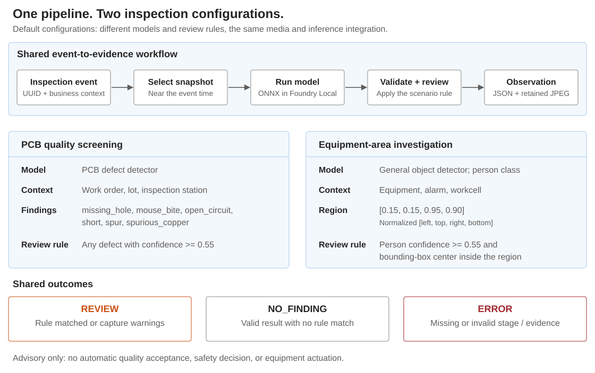
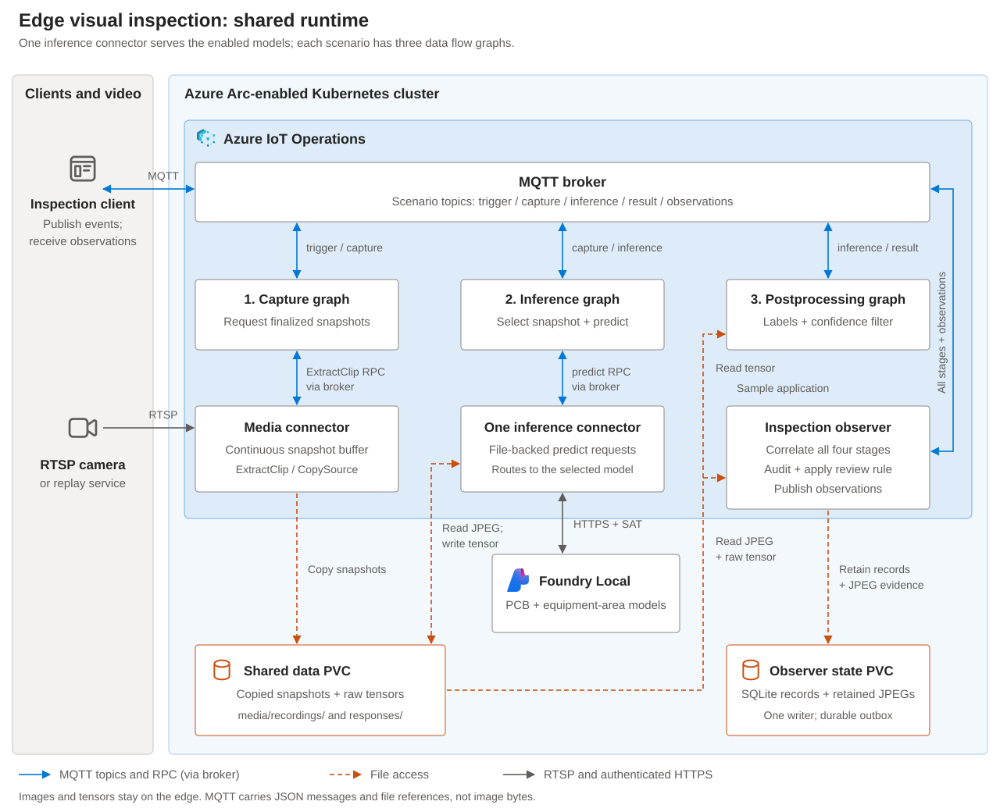

# Tutorial: Event-triggered visual inspection at the edge

Connect a production or equipment event to camera evidence and a machine-learning
observation using Azure IoT Operations. This tutorial combines the media connector,
inference connector, data flow graphs, and Foundry Local to run two inspection
scenarios on your Kubernetes cluster.

You will prepare real ONNX models, publish camera streams, deploy the integration,
submit inspection events, and retrieve the resulting observations and JPEG
evidence. The sample uses actual model inference, not predefined detection
responses. A command-line client supplies the business events for the walkthrough;
connecting a PLC, manufacturing execution system (MES), or alarm publisher is a
separate integration.

> [!IMPORTANT]
> **Preview environment required.** Before starting, confirm access to compatible
> connector, application, Foundry Local, and data flow graph capabilities. This
> pipeline requires the inference graph's **0.3 contract** and compatible media
> graphs and WASM modules from your preview distribution. It cannot use the older
> `0.2.0-preview.0` inference graph. The example artifact references are not a
> guarantee that those artifacts are available in a public registry.
> See the [compatibility requirements](docs/configuration.md#preview-compatibility).

## In this tutorial

- [Understand the customer scenarios](#customer-scenarios)
- [Understand the workflow architecture](#workflow-architecture)
- [Prepare your environment](#prerequisites)
- [Configure, package, and deploy the sample](#1-set-up-the-local-workspace)
- [Run inspections and retrieve evidence](#7-run-the-inspection-scenarios)
- [Connect a customer workflow](#9-connect-your-camera-and-business-workflow)
- [Stop and clean up](#10-stop-and-clean-up)

## Customer scenarios

| Scenario | Customer question | Demonstrated outcome |
| --- | --- | --- |
| **PCB quality screening** | What visible defect candidates were detected on the board associated with this inspection event? | An observation containing defect labels, confidence, bounding boxes, work-order context, and the corresponding board image. |
| **Equipment-area investigation** | Was a person detected inside a configured camera region when this equipment event occurred? | An observation containing person detections, region matches, alarm/equipment context, and the corresponding workcell image. |

These are two configurations of **one integration pattern**, not two different
media workflows. Run either scenario on its own; enable both to demonstrate
multiple models and review policies sharing one inference connector.



Both scenarios are **advisory**. The sample does not certify product quality,
identify workers, diagnose equipment, assess unsafe behavior, or operate a safety
interlock. It never issues equipment commands.

### Scenario A: PCB quality screening

Consider an inspection station where a board is visible to a fixed camera. A
production application associates the inspection with a work order, lot, and
station. The media connector selects a snapshot near the event time, and a
six-class PCB model screens it for visible defect candidates:
`missing_hole`, `mouse_bite`, `open_circuit`, `short`, `spur`, and
`spurious_copper`.

For example, a detected `short` at or above the default confidence threshold of
`0.55` produces `REVIEW`, with its bounding box and the inspection's business
context. The qualified quality process decides whether to accept, rework, or
reject the board; the sample does not make that decision.

An authorized PCB image is required for replay. This model is a community
evaluation baseline trained on a limited PCB domain. A binarized scan, a different
board family, or different lighting can produce no detections even when a defect
is visible. `NO_FINDING` is therefore **not a passing quality result**.

### Scenario B: Equipment-area investigation

Consider a workcell where an equipment alarm or an operator inspection request
needs visual context. A general object detector locates people in the selected
image. A separate, explicit rule checks whether each person's bounding-box center
falls inside a configured image region.

The default region is `[0.15, 0.15, 0.95, 0.90]`, expressed as
`[left, top, right, bottom]` fractions of a 640 x 640 image. It covers pixels
`(96, 96)` through `(608, 576)`. A `person` detection must meet the `0.55`
confidence threshold and have its box center inside that region to become a
review finding.

The downloadable replay is an attributed photograph of a real lighting-factory
workplace. It lets you exercise the complete image-to-observation integration
without a physical camera. It is a **static-scene replay**, not a demonstration of
tracking, changing occupancy, equipment faults, or live alarm detection. Business
identifiers in the commands below are example context, not facts about the
photograph or the people shown.

For both scenarios, a failed capture, invalid inference, missing stage, or evidence
failure follows a third path: **`ERROR`**, not `NO_FINDING`.

## Workflow architecture

The same pipeline runs once for each enabled scenario. Both models share **one
inference connector**; each scenario has its own camera asset, MQTT topic prefix,
Foundry model deployment, and three data flow graphs.



Blue connections represent MQTT topics and command RPCs, all routed through the
broker. Dashed orange connections represent file access; gray connections represent
RTSP video or HTTPS model calls. HTTPS uses service-account token (SAT)
authentication. The client and video inputs are shown logically: the walkthrough
runs its client in the observer pod
and can deploy replay on the same cluster.

Azure Resource Manager deploys application and graph configuration; your registry
supplies images, models, graphs, and modules. Image inference itself runs on the
edge cluster. This sample does not upload camera images to a cloud service.

### What happens for one inspection

For the message order and the files accessed at each stage, see the
[inspection sequence diagram](docs/architecture.md#inspection-sequence).

| Stage | What happens | Why it matters |
| --- | --- | --- |
| Event | The client publishes a UUID, event time, camera asset, and business context. | All later messages can be associated with the same inspection, rather than matched by arrival order. |
| Capture | The media connector copies finalized snapshots from its private buffer to shared storage. | The event has accessible image evidence, even after the private buffer advances. |
| Inference | Preprocessing selects the nearest snapshot; the connector reads that JPEG and calls the selected Foundry model. | Both scenarios use their actual ONNX model and the same authenticated inference path. |
| Postprocessing | The graph resolves model labels and converts the tensor into labeled bounding boxes. | Consumers receive detection objects rather than model-specific tensor arrays. |
| Observation | The observer checks all stages, raw tensor values, model labels, and the inferred image reference, then applies the scenario rule. | Invalid or mismatched output cannot silently become a clean inspection result. |
| Evidence | The observer retains a separate JPEG and publishes the completed observation. | The operator can retrieve the image associated with the finding and its business context. |

The camera records continuously at one snapshot per second. A trigger does **not**
take an immediate photo or wait for future images: it selects finalized snapshots
near a past event, using one second of pre-padding and no post-padding. The helper
uses an event two seconds before publication. Snapshot selection alone does not
establish hardware synchronization between a PLC and a camera.

Model preparation also adapts Foundry's documented ImageNet normalization to the
YOLO models' expected RGB `[0,1]` inputs. Both models use a 640 x 640 canvas and
return `[1,300,6]` detections. See the [architecture and message reference](docs/architecture.md)
for the normalization, file paths, MQTT contracts, and failure semantics.

## Prerequisites

Use a compatible, existing preview environment. This tutorial does not install
Azure Arc, Azure IoT Operations, Foundry Local, or storage drivers.

| Requirement | Details |
| --- | --- |
| Management workstation | Bash, Python 3.10+, Azure CLI with Bicep, `kubectl`, `jq`, ORAS, and Docker. Linux or a suitable WSL environment can be used. |
| Azure and Kubernetes access | An explicit subscription, resource group, IoT Operations instance, custom location, and Kubernetes context; permission to deploy the sample's ARM and Kubernetes resources. |
| IoT Operations | Resources run in `azure-iot-operations`, with compatible media, inference, application, and data flow graph capabilities. |
| Foundry Local | The Kubernetes inference operator with predictive ONNX/CPU support, HTTPS, and service-account authentication. This is not the desktop Foundry Local application. |
| Registry access | A writable OCI registry for the prepared models and observer image; an AIO registry endpoint with read access to compatible preview graphs **and their referenced modules**. |
| Storage | A dedicated ReadWriteMany data PVC and a separate durable, POSIX-locking state PVC. The SQLite state volume must not be an unverified NFS/SMB share. |
| Trust and credentials | Foundry CA Secret, model-registry Secret, observer image-pull Secret, and broker permissions described below. |
| Replay inputs | The supplied factory-photo download for equipment-area replay; your own authorized board image for PCB replay. |

The two model deployments request a total of **2 CPU cores and 2 GiB of memory**
when both scenarios are enabled, in addition to IoT Operations, media, graph, and
observer resources. These are initial requests, not a throughput or sizing guarantee.

> [!IMPORTANT]
> The community models declare **AGPL-3.0** terms. The factory photograph uses
> **CC BY-SA 3.0**. Review [third-party notices](THIRD-PARTY-NOTICES.md) before
> downloading or distributing assets. PCB dataset image rights are separate from
> model-weight licenses; the sample does not download research-only or
> ambiguously licensed board images.

### Authentication and existing installations

Foundry must accept the AIO application's token audience:
**`satAuth.audience: aio-internal`**. Coordinate that installation-level setting
with your platform administrator. The model deployments authorize
`azure-iot-operations/aioappcfg-edge-inference-sa`; the observer uses a separate
`edge-inference-observer` service account.

Prepare these existing Secrets through your approved secret-management process:

| Configuration setting | Namespace | Required contents |
| --- | --- | --- |
| `foundryTrustSecret` | `azure-iot-operations` | Foundry HTTPS CA chain in `ca.crt`. |
| `modelRegistrySecret` | Your Foundry namespace | Registry credentials in `username` and `password` keys. |
| `imagePullSecret` | `azure-iot-operations` | A Kubernetes registry pull Secret, such as `kubernetes.io/dockerconfigjson`. |

The model registry Secret and image-pull Secret have **different formats**. Keep
credentials out of configuration files and commands stored in shell history.

Apply permissions through your existing broker authorizer:

| Identity | MQTT access |
| --- | --- |
| Observer and walkthrough client | Subscribe to the enabled scenarios' `trigger`, `capture`, `inference`, `result`, and `observations`; publish `trigger` and `observations`. |
| Customer event publisher | Publish the relevant `trigger`; optionally subscribe to `observations`. Use a separate identity. |
| Platform connectors and graphs | Their required asset-action, inference RPC, reply, and data flow topics. |

MQTT uses TLS, QoS 1, and MQTT 5 `K8S-SAT` authentication. The sample does not
replace broker policies or grant unrestricted access.

There must be **one inference connector per IoT Operations instance**, and **one
ConnectorTemplate matching `Microsoft.Media`**. If an inference connector already
exists, integrate the model entries into it rather than deploying a second one.
For an existing media template, configure reuse and have its owner reconcile the
storage settings. Review [existing-installation guidance](docs/configuration.md#existing-installations)
before running deployment commands.

## 1. Set up the local workspace

From the repository root:

```bash
cd samples/edge-inference
python3 -m venv .venv
source .venv/bin/activate
python -m pip install -r requirements.txt -r requirements-deploy.txt -r requirements-models.txt
cp config.example.json config.json
```

If you already have `config.json`, update it using the example instead of
overwriting it. Run the remaining commands from this sample directory with the
virtual environment activated.

Local configuration, downloaded assets, rendered resources, and exported state
are ignored by Git under `config.json`, `.assets/`, `.generated/`, and `.state/`.

## 2. Choose and configure your scenarios

Edit `config.json` and replace every `REPLACE_WITH` value. The JSON schema provides
editor assistance and is checked before deployment.

| Settings | What to supply |
| --- | --- |
| `subscriptionId`, `resourceGroup`, `aioInstanceName`, `customLocationName` | Existing Azure resource identifiers and names. |
| `kubeContext` | The intended context from `kubectl config get-contexts`. |
| `foundryNamespace` and the three Secret settings | Your installed Foundry namespace and the prerequisite Secret names. |
| `modelRegistry`, `modelTag`, `collectorImage` | Your target registry and versioned model/image references. |
| `dataClaimName`, `stateClaimName` | Two different claims reserved for this sample. |
| `graphRegistryEndpointName`, `graphs` | Your preview graph registry endpoint and compatible artifact references. |
| `mediaTemplateName`, `useExistingMediaTemplate` | The new sample template name, or the existing template to reuse. |
| `enabledScenarios`, `cameras` | Which scenarios to run and their camera addresses/authentication. |

The example enables both scenarios. For a first run without a PCB image, use:

```json
"enabledScenarios": ["equipment-area"]
```

To demonstrate both, keep:

```json
"enabledScenarios": ["pcb-quality", "equipment-area"]
```

Keep the example camera addresses and `Anonymous` authentication for internal
replay. Live-camera settings are covered in [step 9](#9-connect-your-camera-and-business-workflow).
Skip scenario-specific commands for any scenario you have not enabled.

Validate configuration without downloading models or changing cloud resources:

```bash
python render.py config.json --validate-only
KUBE_CONTEXT=$(jq -r .kubeContext config.json)
FOUNDRY_NAMESPACE=$(jq -r .foundryNamespace config.json)
```

The [configuration reference](docs/configuration.md) describes every setting,
preview contract, reserved resource name, and reuse constraint.

## 3. Prepare models and replay images

After reviewing the upstream licenses, prepare the selected models:

```bash
while IFS= read -r scenario; do
  python models/prepare.py prepare --scenario "$scenario" \
    --acknowledge-third-party-licenses
done < <(jq -r '.enabledScenarios[]' config.json)
```

The helper verifies pinned download checksums, adapts the ONNX input/output
contract, and creates `.assets/models/<scenario>/model.tar.gz`. Each archive
includes the model, labels, license, preparation script, and provenance.

For **equipment-area replay**, download and letterbox the licensed factory image:

```bash
python models/prepare.py factory-image
```

For **PCB replay**, letterbox an image you are authorized to use:

```bash
python models/prepare.py letterbox /path/to/authorized-board.jpg \
  .assets/replay/pcb-quality.jpg
```

Letterboxing preserves aspect ratio and pads the image to 640 x 640. Keep the
factory photograph's attribution and share-alike terms with any distributed replay
media. No board image is supplied or implicitly cleared for commercial use.

Run local inference for every selected replay image:

```bash
while IFS= read -r scenario; do
  python models/prepare.py smoke --scenario "$scenario" \
    --image ".assets/replay/$scenario.jpg"
done < <(jq -r '.enabledScenarios[]' config.json)
```

Successful output includes `"adapterEquivalent": true` and the model's detections.
This compares the original model with its Foundry-adapted version; it does not
measure model accuracy or validate a deployed Foundry service. Investigate missing
or implausible detections before proceeding, especially for board images outside
the PCB model's training domain.

## 4. Publish the models and observer image

The following commands use Azure Container Registry. For another OCI registry,
use its approved login method and the same repository/tag layout.
For this build path, place `collectorImage` in the same authenticated ACR and
use an explicit tag rather than a digest.

```bash
SUBSCRIPTION_ID=$(jq -r .subscriptionId config.json)
MODEL_REGISTRY=$(jq -r .modelRegistry config.json)
MODEL_TAG=$(jq -r .modelTag config.json)
COLLECTOR_IMAGE=$(jq -r .collectorImage config.json)
ACR_NAME="${MODEL_REGISTRY%%.*}"

az acr login --subscription "$SUBSCRIPTION_ID" --name "$ACR_NAME"

while IFS= read -r scenario; do
  (
    cd ".assets/models/$scenario"
    oras push "$MODEL_REGISTRY/models/edge-inference/$scenario:$MODEL_TAG" model.tar.gz
  )
done < <(jq -r '.enabledScenarios[]' config.json)

docker build --tag "$COLLECTOR_IMAGE" .
docker push "$COLLECTOR_IMAGE"
```

An existing build pipeline can publish the observer instead.
Protect deployed tags from replacement. Retain model hashes and notices:
recorded provenance identifies the prepared package, but cannot attest that a
mutable registry tag still contains that package.

## 5. Provision storage and review generated resources

If you do not already have suitable dedicated claims:

```bash
mkdir -p .generated
cp kubernetes/storage.example.yaml .generated/storage.yaml
```

Edit `.generated/storage.yaml` to select suitable storage classes and capacity.
Ensure the claim names match `config.json`, then apply the file:

```bash
kubectl --context "$KUBE_CONTEXT" apply -f .generated/storage.yaml
```

The initialization Job runs as UID/GID `65532` and checks write access. Storage
drivers must support the required access modes and ownership handling. These
claims must not contain another workload's data.

Render the remaining resources:

```bash
bash deploy.sh render config.json
```

Review `.generated/` before deployment. It contains camera and model manifests,
observer configuration, storage initialization, tensor cleanup, and three ARM
parameter files. Rendering verifies local model and label checksums but makes
**no Azure or Kubernetes changes**. Use individual manifests; do not bulk-apply
the directory, which can retain files from earlier scenario selections.

## 6. Deploy and enable the workflow

Start the selected replay cameras, then deploy the integration:

```bash
bash deploy.sh replay config.json
bash deploy.sh deploy config.json
```

Replay uses a digest-pinned MediaMTX/FFmpeg image with an internal ClusterIP
service. Only loopback publishing is permitted. For physical cameras, omit the
`replay` command.

Deployment initializes the shared directories, registers camera assets, deploys
the inference application definition, and waits before deploying its
configuration. It then creates the Foundry models, observer, cleanup job, and
**disabled** data flow graphs. The definition/configuration separation is required
by application admission.

Inspect the deployed workloads and observer logs:

```bash
kubectl --context "$KUBE_CONTEXT" -n "$FOUNDRY_NAMESPACE" get modeldeployments \
  -l app.kubernetes.io/part-of=edge-inference-sample

kubectl --context "$KUBE_CONTEXT" -n azure-iot-operations get deployments \
  -l app.kubernetes.io/part-of=edge-inference-sample

kubectl --context "$KUBE_CONTEXT" -n azure-iot-operations \
  logs deployment/edge-inference-observer --tail=30
```

The deployment command waits for `Running` models, healthy `camera-snapshots`
streams and `ExtractClip` actions, and a ready observer. Observer readiness means
its broker subscriptions were acknowledged; a replay service's open RTSP port
alone does not prove that frames are being recorded.

Confirm graph/module access and the installed Foundry preprocessing contract with
your preview environment documentation. Allow several seconds of camera recording,
keep production publishers disconnected, and enable the graphs for the walkthrough:

```bash
bash deploy.sh enable config.json
```

This rechecks model, camera, and observer readiness and enables the existing
graphs downstream-first. It does not regenerate model packages or redeploy graph
definitions. The first controlled inspections below establish whether the
complete runtime path works; successful provisioning alone does not establish that.

## 7. Run the inspection scenarios

Run commands sequentially. Media file actions are serialized across assets on a
connector; overlapping requests can return `Busy`.

### Equipment-area inspection

```bash
kubectl --context "$KUBE_CONTEXT" -n azure-iot-operations \
  exec deployment/edge-inference-observer -- \
  python mqtt_client.py trigger --scenario equipment-area \
  --context '{"equipmentId":"assembly-cell-04","alarmId":"inspection-requested","stationId":"CELL-04"}'
```

The client prints a new `publishedInspectionId`, then waits for that inspection's
observation. With a person detected above threshold inside the configured region,
expect `REVIEW`. Inspect `reviewDetections` to see which detections matched the
region rule; `detections` contains all validated detections returned by the graph.

For a controlled comparison, use your own authorized image with no person in the
region, or a reviewed region that excludes the detected box centers. Follow the
[update procedure](docs/operations.md#change-models-policies-or-scenarios) before
changing images or policy. Do not move the region merely to obtain a desired
result in an operational workflow.

### PCB quality inspection

```bash
kubectl --context "$KUBE_CONTEXT" -n azure-iot-operations \
  exec deployment/edge-inference-observer -- \
  python mqtt_client.py trigger --scenario pcb-quality \
  --context '{"workOrder":"WO-1042","lotId":"LOT-17","stationId":"AOI-01"}'
```

If the supplied board image produces a configured defect candidate above
threshold, expect `REVIEW` with its label, confidence, and bounding box. If it does
not, inspect the image and domain assumptions; `NO_FINDING` must not be interpreted
as an accepted board. Use labeled positive and negative images from your intended
board family to assess whether this baseline is appropriate.

### Interpret the observation

| Status | Meaning | Consumer action |
| --- | --- | --- |
| `REVIEW` | A configured finding, or usable evidence with capture warnings. | Present the image, detections, warnings, and business context for review. |
| `NO_FINDING` | Validated inference and retained evidence, with no configured finding. | Record the observation without claiming quality acceptance or safety. |
| `ERROR` | Capture, inference, correlation, timing, or evidence validation failed. | Investigate the reason; do not treat it as an empty detection result. |

For example, an equipment-area observation can contain the following fields.
This is an **abridged illustration**; UUID, confidence, coordinates, and hashes
come from your actual run:

```json
{
  "schemaVersion": 1,
  "inspectionId": "aa864fe0-2f5a-432f-9be1-cc905d883d8c",
  "scenario": "equipment-area",
  "assetId": "edge-area-camera",
  "context": {
    "equipmentId": "assembly-cell-04",
    "alarmId": "inspection-requested",
    "stationId": "CELL-04"
  },
  "model": "edge-equipment-area",
  "status": "REVIEW",
  "reason": "Operator review required",
  "confidenceThreshold": "0.55",
  "reviewDetections": [
    {"label": "person", "confidence": 0.91, "box": [150, 284, 304, 480]}
  ],
  "automaticActuation": false
}
```

The complete record also includes timestamps, policy, model provenance, all
detections, inference time, tensor hash, capture warnings, and evidence
filename/hash. Boxes use `[x1, y1, x2, y2]` coordinates on the 640 x 640 model
canvas. Images are not embedded in MQTT messages.

The client returns nonzero for `ERROR` or a timeout. If no observation arrives,
use the printed inspection UUID and the [troubleshooting guide](docs/operations.md#troubleshooting).
The default inspection deadline is 180 seconds; absence of a response is never
a successful inspection.

## 8. Retrieve the observation and image evidence

Use the actual UUID printed by your trigger command:

```bash
INSPECTION_ID=the-uuid-from-your-observation
mkdir -p .state

kubectl --context "$KUBE_CONTEXT" -n azure-iot-operations \
  exec deployment/edge-inference-observer -- \
  python mqtt_client.py records --inspection-id "$INSPECTION_ID" \
  > ".state/$INSPECTION_ID.json"

kubectl --context "$KUBE_CONTEXT" -n azure-iot-operations \
  exec deployment/edge-inference-observer -- \
  python mqtt_client.py evidence --inspection-id "$INSPECTION_ID" \
  > ".state/$INSPECTION_ID.jpg"
```

The evidence command verifies the retained image's size and SHA-256 against the
observation before writing bytes. Open the JSON and JPEG locally, compare the
finding with the scene, and review the recorded capture offset. The image is the
original retained capture, not an annotated overlay.

To list recent observations:

```bash
kubectl --context "$KUBE_CONTEXT" -n azure-iot-operations \
  exec deployment/edge-inference-observer -- \
  python mqtt_client.py records --limit 20
```

Completed records and evidence are retained for seven days by default and pruned
only after publication. Export required evidence before expiry. Delivery is
**at least once**: downstream consumers must deduplicate by `inspectionId`.

## 9. Connect your camera and business workflow

### Replace replay with a physical camera

Configure the selected `cameras.<scenario>` entry in `config.json`. For example:

```json
{
  "address": "rtsps://camera.example.com:322/stream",
  "authentication": {
    "method": "UsernamePassword",
    "usernamePasswordCredentials": {
      "usernameSecretName": "workcell-camera-username",
      "passwordSecretName": "workcell-camera-password"
    }
  }
}
```

Provision the camera secret references through AIO secret management and configure
the camera CA trust in the media template before using RTSPS. Authentication
settings are rendered into the Device resource; they are not manual edits that
disappear on the next deployment. See [live-camera configuration](docs/configuration.md#live-cameras).

Provide a 640 x 640 camera profile or a suitable letterboxing gateway. Foundry's
resize is not letterboxing. Align the configured region with the model canvas and
calibrate thresholds using the actual camera, optics, lighting, and subject domain.

### Publish business events and consume observations

Replace the walkthrough client with a customer publisher that preserves the
[trigger message contract](docs/architecture.md#trigger-contract), including the
UUID and event-time MQTT properties. Publish to
`edge-inference/<scenario>/trigger`; consume
`edge-inference/<scenario>/observations`.

For quality workflows, attach the observation to the work order or quality record.
For equipment investigations, attach it to the alarm or maintenance record.
A separate downstream data flow can forward observations to a supported historian
or cloud endpoint. A customer application must provide any dashboard, case
management, or image-transfer integration; those components are not deployed here.

Before operational use, exercise known positive/negative images and camera/model
failures, verify evidence alignment, measure false positives/negatives and latency,
and size retention for your event rate. See the [acceptance checklist](docs/operations.md#acceptance-before-operational-use).
Additional equipment-health models, acoustic inference, generative reasoning,
and automatic control require separate validated integrations. For independent
camera-control examples, see the [ONVIF PTZ sample](../aio-onvif-connector-ptz-demo/README.md).

## 10. Stop and clean up

Stop event publishers first. Let pending inspections complete and publish:

```bash
kubectl --context "$KUBE_CONTEXT" -n azure-iot-operations \
  exec deployment/edge-inference-observer -- \
  python mqtt_client.py records --pending
```

When this returns no records, disable the sample graphs:

```bash
bash deploy.sh disable config.json
```

The disable command targets all recognized sample graphs in the `edge-inference`
profile, including a previously enabled scenario. It does not require local model
files or a Kubernetes connection. Export required records and images, then follow
the [resource-specific cleanup procedure](docs/operations.md#remove-sample-resources).
The sample does not automatically delete PVCs, shared templates, credentials, or
the underlying platform.

## Reference and development

| Document | Contents |
| --- | --- |
| [Configuration](docs/configuration.md) | Preview compatibility, settings, identities, storage, existing installations, and live cameras. |
| [Architecture and contracts](docs/architecture.md) | Graph responsibilities, model adaptation, file layout, MQTT messages, and observation semantics. |
| [Operations](docs/operations.md) | Diagnostics, retention, configuration changes, acceptance, and cleanup. |
| [Development](docs/development.md) | Source layout, formatting, local tests, and model/container verification. |
| [Third-party notices](THIRD-PARTY-NOTICES.md) | Model/media provenance, licenses, attribution, and distribution considerations. |
