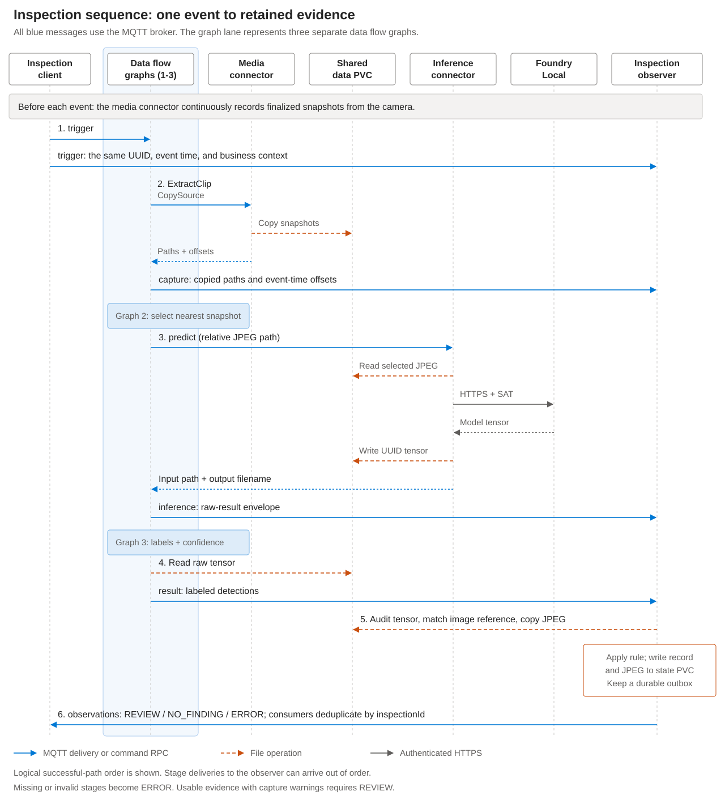

# Architecture and message contracts

[Back to the tutorial](../README.md)

## Component responsibilities

Each enabled scenario has three data flow graphs, connected by MQTT topics.
Splitting inference from postprocessing gives the observer access to both the raw
inference reference and the final detections.

| Component | Responsibility |
| --- | --- |
| Camera Device and Asset | Declare the media endpoint, continuous `camera-snapshots` stream, and `ExtractClip` management action. |
| Capture graph | Invoke the media action for the trigger event and publish its response. |
| Inference graph | Select a snapshot, derive its relative path, invoke the configured model, and publish the raw inference envelope. |
| Inference connector | Read the image from shared storage, authenticate to Foundry, and write the returned tensor to a UUID-named file. |
| Foundry model deployment | Execute the adapted predictive ONNX model and expose model metadata/labels. |
| Postprocessing graph | Read the tensor, resolve labels, apply the confidence threshold, and publish detection objects. |
| Observer | Correlate and persist stages; validate tensor, detections, and image reference; apply the review policy; retain evidence and publish observations. |
| Response cleanup CronJob | Remove expired UUID-named tensor files from the response directory only. |

The media connector's `ExtractClip` action copies already-finalized snapshots.
It does not request a new physical exposure or wait for future snapshots. The
capture graph requests one second of pre-padding and zero post-padding. Selection
minimizes the absolute event-time offset; ties prefer the earlier image.

`Copied` and `Skipped` source entries are eligible. A usable capture can contain
both `Result` and `Error`, or individual copy failures. Those conditions are
preserved as warnings and require review; they are not silently retried or
converted into `NO_FINDING`.

## Inspection sequence

The diagram follows one inspection through the three graphs and the observer.
All blue messages, including command RPCs, travel through the MQTT broker.
Deliveries to the observer are shown separately from graph processing; they can
arrive out of order. Model metadata lookups and broker acknowledgements are omitted.



## Model adaptation

The pinned community models are end-to-end detectors with:

```text
Input:  float32 [1, 3, 640, 640]
Output: float32 [1, 300, 6]
Row:    [x1, y1, x2, y2, confidence, class_id]
```

Raw YOLO heads such as `[1,4+C,8400]` require a different postprocessor and cannot
be substituted directly.

Foundry's documented predictive image API decodes the image, converts it to RGB,
resizes, scales values to `[0,1]`, applies ImageNet normalization, and produces
NCHW input. The source YOLO models expect RGB `[0,1]` without ImageNet normalization.
The preparation helper inserts the inverse operations:

```text
Foundry input = (RGB / 255 - mean) / std
YOLO input   = Foundry input * std + mean
mean         = [0.485, 0.456, 0.406]
std          = [0.229, 0.224, 0.225]
```

It also names the output `detections` and includes the model's `id2label` map.
Foundry adds the output index, producing the JSON key **`detections_0`**.
The package has these files:

```text
LICENSE
config.json
model.onnx
prepare.py
provenance.json
```

The helper checks source hashes, rejects incompatible shapes and externally
stored initializers, and normalizes archive timestamps and ownership. Provenance
records the source revision/hash and the prepared model and label-file hashes.

The local smoke command runs the original and adapted models with the respective
preprocessing. It compares detections above the sample threshold, allowing small
numeric differences. It does not validate camera accuracy, a registry's current
tag contents, or a deployed Foundry service's preprocessing.

Use the documented Foundry image contract for your installed release. A custom
runtime with different preprocessing requires a matching adapter. Model metadata
can be inspected with the inference connector's `getModelInfo` command through
an [AIO SDK command invoker](https://github.com/Azure/iot-operations-sdks/blob/main/doc/components.md#command-invoker),
or by an authorized HTTPS client calling Foundry `GET /v1/model`.
The request topic is:

```text
aio/inference/command/getModelInfo/model_name/<modelName>
```

The request body is `{}`. Use the SDK's RPC correlation, response-topic, and
timeout handling; a plain MQTT publication without those RPC properties is not
a complete command invocation.

## File layout

The shared data PVC has two sample-owned subdirectories:

```text
edge-inference/
  media/
    recordings/
      <device>/rtsp/<asset>/camera-snapshots/<file>.jpg
  responses/
    <canonical UUID>
```

The same capture is visible through different component mounts:

| View | Path |
| --- | --- |
| Media shared root | `/inference-shared/edge-inference/media` |
| Capture `TargetPath` | `recordings/<device>/rtsp/<asset>/camera-snapshots/<file>.jpg` |
| Connector read directory | `/data/edge-inference/media/recordings` |
| Preprocessed input reference | `<device>/rtsp/<asset>/camera-snapshots/<file>.jpg` |
| Connector response directory | `/data/edge-inference/responses` |
| Postprocessing file store | Data PVC subpath `edge-inference/responses`, read-only. |
| Observer mounts | `/media` and `/responses`, read-only; a separate writable `/state`. |

The preprocessor retains the final five path segments. **Do not set
`strip_path_prefix`** with this relative-path layout. Changing a mount, endpoint
name, stream name, or shared root requires corresponding changes across all views.

Retained state is separate:

```text
/state/
  inspections.db
  <inspectionId>.jpg
```

The observer opens capture path components without following symlinks, copies a
bounded image, and uses file/directory synchronization and atomic rename before
recording completed evidence. Raw tensors are read through a no-follow directory
descriptor. The state volume must be trusted, durable storage for one writer.

## MQTT topics

Each scenario uses the following topics:

| Topic suffix | Payload |
| --- | --- |
| `trigger` | Inspection event and business context. |
| `capture` | Media action response with source files, offsets, and copy status. |
| `inference` | Inference `Result`/`Error` envelope with input/output file references. |
| `result` | Postprocessed detection array, or an error. |
| `observations` | Completed, correlated inspection observation. |

The prefix is `edge-inference/<scenario>` by default. MQTT messages use QoS 1,
TLS, and MQTT 5 authentication. Event messages must not be retained.

### Trigger contract

Every trigger must include exactly one of each MQTT user property:

| Property | Value |
| --- | --- |
| `trigger-id` | Canonical lowercase UUID; reused unchanged for retries of the same inspection. |
| `__ts` | `<event epoch milliseconds, zero-padded to 15 digits>:00000:<publisher-node-id>`. |

The body is a JSON object:

```json
{
  "inspectionId": "aa864fe0-2f5a-432f-9be1-cc905d883d8c",
  "assetId": "edge-area-camera",
  "eventTime": "2026-01-20T10:15:30Z",
  "triggeredAt": "2026-01-20T10:15:32Z",
  "context": {
    "equipmentId": "assembly-cell-04",
    "alarmId": "inspection-requested"
  }
}
```

This is a schema illustration, not a replayable current event. Generate current
timestamps when publishing. `inspectionId` must match `trigger-id`; `assetId`
must match the configured camera. `eventTime` must match `__ts`.
`triggeredAt` is the publication time used to calculate the inspection deadline.
Both timestamps require a time zone. `context`, when present, must be an object.

The helper chooses an event two seconds before publication and restricts explicit
event times to the preceding ten-minute private snapshot window. Synchronize
publisher, camera-processing, and cluster clocks. The retained capture offset is
useful for commissioning, but is not proof of camera/PLC hardware synchronization.

### Raw inference and postprocessing

The inference graph must return the input reference
(`return_input_payload=true`). The successful envelope contains a `Result` object with `model`,
`inferenceTimeMs`, and `input`/`output` objects. Their `data` fields contain
UTF-8 file references encoded as byte arrays. The output filename is a canonical
UUID, not the tensor embedded in the MQTT message.

The tensor file contains one `detections_0` batch with exactly 300 six-value rows.
The observer validates every row, including rows below threshold. It checks
finite values, confidence range, class IDs, and coordinate bounds. It reconstructs
the expected postprocessed detections using float32 conversion and integer
truncation consistent with the graph.

The result topic contains detection objects such as:

```json
[
  {
    "label": "person",
    "confidence": 0.91,
    "box": [150, 284, 304, 480]
  }
]
```

The observer compares labels, coordinates, confidence, and detection count against
the tensor. It also compares the returned input reference with the selected
capture path. A wrong image reference, malformed tensor, stale label map, or
silently dropped malformed row becomes `ERROR`, not an empty successful result.

### Observation contract

| Field | Meaning |
| --- | --- |
| `schemaVersion`, `inspectionId`, `scenario`, `assetId` | Record schema and correlation identifiers. |
| `eventTime`, `triggeredAt`, `completedAt` | Event, publication, and completion timestamps. |
| `context` | Business identifiers supplied with the event. |
| `model`, `modelProvenance` | Configured model, source revision/hash, prepared model/label hashes, and deployment tag. |
| `policy`, `confidenceThreshold` | Settings used to interpret this inspection. |
| `coordinateSpace` | Model canvas width/height. |
| `detections`, `reviewDetections` | Validated detections and the subset matching the review policy. |
| `inference` | Reported inference time, tensor filename, and tensor SHA-256. |
| `captureWarnings` | Partial failures or coverage warnings accompanying usable evidence. |
| `evidence` | Retained filename, byte count, SHA-256, capture path, and event-time offset. |
| `status`, `reason` | `REVIEW`, `NO_FINDING`, or `ERROR`, with a human-readable explanation. |
| `automaticActuation` | Always `false`. |

Error records can lack detections, inference details, or evidence when those
stages could not be completed. Clients must inspect `status` before treating
other fields as successful outputs.

## Persistence and failure behavior

The observer accepts out-of-order stages and exact duplicate messages. It never
assigns a response to the oldest pending event. Conflicting duplicates before
completion produce an error; terminal observations remain immutable and late
messages are logged.

Deadlines are measured from `triggeredAt`, not from the arrival of the last stage.
Orphaned capture/inference/result messages also expire. Messages without usable
correlation are rejected and logged; no trustworthy inspection record can be
invented for a missing UUID.

Incoming messages are acknowledged after durable processing. Completed
observations remain in an outbox until broker acknowledgement. A crash between
publication and marking the row sent can cause republication: consumers must
deduplicate by `inspectionId`. This is **at-least-once delivery**.

The observer stores a configuration fingerprint and rejects a settings change
while inspections are pending or unpublished. Keep the previous configuration
and image available to drain work before an update.

Limits include 1 MiB per incoming JSON message/tensor file, 16 MiB per retained
image, a 100-message transport queue, and a default capacity of 10,000 inspections.
Capacity or storage failures stop processing rather than acknowledge work that
could not be persisted. See [operations](operations.md) for retention and recovery.
