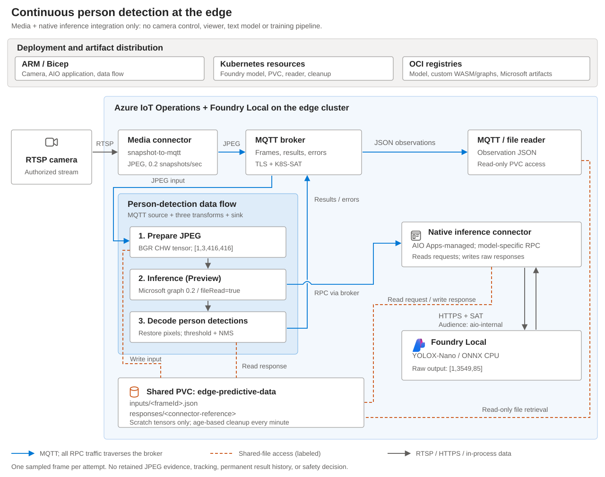

# Edge predictive inference: person-detection scenario

This sample integrates the Azure IoT Operations (AIO) **media connector** and **native
inference connector** to produce person detections from an RTSP camera. Foundry
Local hosts the YOLOX-Nano ONNX model, while a data flow graph prepares images
and converts model outputs into MQTT observations.

Each successful observation includes the detection count, confidence scores,
bounding boxes, and references to its model input and output files. This provides
both an application-facing result and a way to inspect the data used for inference.

**Use the sample:** [Build and run locally](#build-and-run-locally) |
[Deploy](#deployment-and-operations) | [Run and observe](#run-and-observe-the-pipeline) |
[Test](#tests-and-validation) | [Stop and clean up](#stop-and-clean-up).

> [!IMPORTANT]
> **Preview environment required.** This scenario depends on compatible AIO Apps,
> media connector, data flow graph/file-store, WASM, and Foundry Local operator
> capabilities. Review the [compatibility requirements](docs/architecture.md#compatibility)
> and [deployment prerequisites](docs/deployment.md#prerequisites).
> Foundry Local here is the Kubernetes predictive-model operator, not the desktop
> application.

## Scenario

A fixed camera overlooks a workcell or equipment area. An operations application
needs frame-level observations of people in that scene without implementing its
own camera ingestion or model-serving client.

The media connector samples one JPEG every five seconds by default. Image
preparation, model execution, and detection decoding run on the edge cluster.
A consuming application can display the latest detections or store observations
for review. Those application components are not part of this sample.

The sample focuses on **one camera, one person-detection model, and one processing
pipeline**. It includes the model, WASM components, deployment resources, artifact
publication, a read-only result/file inspection pod, and temporary-file cleanup.
Camera control, video playback, long-term evidence storage, model training, and
automated actuation are outside its scope.

Here, **predictive** is Foundry Local's ONNX workload type. The scenario detects
people in current images; it does not forecast future behavior or equipment
failures.

## Architecture



The media connector publishes JPEGs to the MQTT broker. A single managed data
flow graph contains five nodes:

| Node | Responsibility | Output |
| --- | --- | --- |
| Camera source | Subscribe to sampled camera images. | JPEG bytes and MQTT metadata. |
| Preprocess | Decode, resize, pad, and arrange the image for YOLOX-Nano. | A prepared tensor file, its reference, and frame context. |
| Inference (Preview) | Invoke the native inference connector through MQTT RPC. | The connector's response-file reference. |
| Postprocess | Decode model output, filter person detections, and suppress overlapping boxes. | An observation or a contextual postprocessing error. |
| Observation destination | Publish JSON to the appropriate MQTT topic. | Results for downstream applications. |

Two custom WebAssembly (WASM) components implement preprocessing and
postprocessing. They do not host the model or call it over HTTP. The **native
inference connector** reads the prepared request, calls Foundry Local over HTTPS
with service-account-token authentication, and writes the raw response.

The connector is managed through **AIO application definition and configuration
resources**, deployed with Bicep. The camera and data flow are also managed
through Azure Resource Manager (ARM). Kubernetes manifests configure the Foundry
model, shared storage, reader, and cleanup job. The sample reuses the existing
media connector installation.

See [architecture and data contracts](docs/architecture.md) for the request
sequence, tensor formats, authentication boundary, and file-access relationships.

## Inputs and outputs

The default topic prefix is `edge/predictive-inference/person`. The shared
persistent volume claim (PVC) is `edge-predictive-data`; both are configurable.

| Data | Default location | Contents |
| --- | --- | --- |
| Camera input | MQTT `edge/predictive-inference/person/frames` | JPEG bytes sampled from the RTSP stream. |
| Detection result | MQTT `edge/predictive-inference/person/results` | Observation JSON with detections and file references. |
| Postprocessing error | MQTT `edge/predictive-inference/person/errors` | Error JSON with available frame and file context. |
| Prepared model input | PVC `edge-predictive-inference/inputs/<frameId>.json` | BGR tensor, shape `[1,3,416,416]`. |
| Raw model output | PVC `edge-predictive-inference/responses/<response-reference>` | JSON `output_0` tensor, shape `[1,3549,85]`. |

The request and response files remain temporarily on the **same PVC**. They are
model tensors, not complete MQTT/HTTP envelopes. The original JPEG and final
observation history are not stored there. The model server receives tensor data
over HTTPS and does not mount this claim.

### Example observation

The following illustrates a successful result containing one person detection.
Values are representative, not a guaranteed result for a particular camera:

```json
{
  "schemaVersion": 1,
  "status": "ok",
  "frameId": "cc3c9f49-e499-423c-bb6b-82a4a4931265",
  "cameraId": "edge-person-camera",
  "modelName": "edge-person-yolox",
  "inferenceHost": "foundry-local",
  "processingStartedAtUnixMs": 1793304000000,
  "processedAtUnixMs": 1793304000422,
  "processingMilliseconds": 422,
  "image": {"width": 640, "height": 360},
  "scoreThreshold": 0.3,
  "nmsThreshold": 0.45,
  "personCount": 1,
  "detectionLimitReached": false,
  "detections": [
    {"label": "person", "confidence": 0.82, "bbox": [120, 45, 205, 310]}
  ],
  "files": {
    "request": "cc3c9f49-e499-423c-bb6b-82a4a4931265.json",
    "response": "452b3cd7-4e50-4707-8fa4-b426b61c51e7"
  }
}
```

Bounding boxes are `[left, top, right, bottom]` in original-image pixels. The
default confidence threshold is `0.30`; nonmaximum suppression uses an
intersection-over-union (IoU) threshold of `0.45`. At most 100 detections are returned. When
`detectionLimitReached` is true, the count must not be treated as total occupancy.

`frameId` identifies one processing attempt and links it to the request file.
`files.response` identifies the connector-generated output file. The timestamps
measure processing, not camera capture; IDs do not track a person across frames.

### Interpreting results

| Outcome | Meaning |
| --- | --- |
| `status: "ok"` with detections | The model produced qualifying person detections for this sampled image. |
| `status: "ok"`, `personCount: 0`, `detections: []` | Inference succeeded with no detections above the threshold. This does not prove that the area is empty. |
| `status: "error"` on `/errors` | Postprocessing failed with valid frame context. No successful count or detection list is included. |
| No observation | Investigate camera, graph, connector, model, or storage availability. Silence is not a zero-person result. |

The error topic does not cover every failure: preprocessing and built-in inference
failures can log and drop a message without producing an observation. See the
[failure contract](docs/architecture.md#failure-behavior).

## Build and run locally

Local execution requires Linux or WSL, Bash, Python 3.10+, Rustup, and native
build tools for Rust's linker. From the repository root:

```bash
cd samples/edge-predictive-inference
python3 -m venv .venv
source .venv/bin/activate
python -m pip install -r requirements.txt -r models/requirements.txt
./build.sh
python models/prepare.py
```

`build.sh` checks Rust formatting, runs the core unit tests, and builds both WASM
components and the native validation helper under `.build/`. Rustup installs the
pinned toolchain when needed. `prepare.py` downloads and verifies the model and
its license under `.assets/model/`.

Run inference on an authorized JPEG image:

```bash
python models/verify.py --image /absolute/path/to/authorized-camera-image.jpg
```

The command prints an observation JSON object and saves the prepared tensor,
raw response, frame context, and observation under `.build/local-inference/`.
It uses the same Rust preprocessing and postprocessing as the deployed components,
with ONNX Runtime on the local CPU.

This local run does **not** use a camera stream, MQTT, the native inference
connector, or Foundry Local. Deploy the pipeline below to exercise those
integrations.

## Deployment and operations

Use an existing compatible Azure IoT Operations environment with the media
connector, Foundry Local, an authorized camera, an OCI registry, and
ReadWriteMany (RWX) storage. Deployment also requires Azure CLI with Bicep,
`kubectl`, `jq`, and ORAS 1.2+. Authenticate Azure CLI and ORAS before proceeding.

Complete the [deployment prerequisites](docs/deployment.md#prerequisites),
including [trust, credentials, and permissions](docs/deployment.md#trust-credentials-and-permissions).
These commands do not install Azure IoT Operations, Foundry Local, or a storage
driver. Run them in order from the sample directory with `.venv` active, and
stop if a command fails.

> [!IMPORTANT]
> The deployment helper is for an **initial installation on an instance without
> another inference connector**. Do not install a second connector. For an
> existing installation, coordinate changes with its owner and follow
> [managed updates](docs/operations.md#managed-updates).

### Configure and publish

Create your environment configuration:

```bash
cp config.example.json config.json
```

Edit `config.json` and replace every `REPLACE_WITH_` value. Set the subscription,
resource names, Kubernetes context, camera URL, secret references, registry, and
RWX storage class. Use new sample resource names rather than reusing unrelated
resources. Do not put credentials in the camera URL or commit secrets.
`modelEndpoint` must be the model's HTTPS base URL, without `/v1/predict`.

Render the configuration and publish the prepared model and graph artifacts:

```bash
python render.py config.json &&
./publish.sh config.json
```

The renderer writes deployment files to `.generated/`, with the camera and data
flow disabled. Publication uploads the two WASM components, two custom graphs,
and YOLOX-Nano model to your registry. Edit source configuration, not generated
files; the helpers render them again.

### Deploy storage and the model

```bash
./deploy.sh preflight config.json &&
./deploy.sh storage config.json &&
./deploy.sh model config.json
```

Inspect the Foundry model before installing the connector:

```bash
CONTEXT=$(jq -er '.kubeContext' config.json)
MODEL=$(jq -er '.modelName' config.json)
FOUNDRY=$(jq -er '.foundryNamespace' config.json)
kubectl --context "$CONTEXT" get modeldeployment "$MODEL" -n "$FOUNDRY" -o yaml
```

Wait for the model to report readiness. Confirm its HTTPS endpoint, CA trust, and
token audience `aio-internal`; update `modelEndpoint` if the reported base URL
differs. An accepted manifest alone does not mean the model is serving.

### Deploy the connector and data flow

```bash
./deploy.sh definition config.json &&
./deploy.sh connector config.json &&
./deploy.sh camera config.json &&
./deploy.sh flow config.json &&
./deploy.sh reader config.json &&
./deploy.sh status config.json
```

The definition step waits for application metadata readiness before creating
the application configuration. Confirm that the connector is running, both graph
file stores are present, graph artifacts resolve, and the model and reader are
ready. The camera and data flow remain disabled until explicitly enabled.

## Run and observe the pipeline

Start processing; the helper enables the graph before the camera:

```bash
./deploy.sh enable config.json
```

Read five results or errors through the authenticated reader, with a 90-second
timeout:

```bash
CONTEXT=$(jq -er '.kubeContext' config.json)
PREFIX=$(jq -er '.topicPrefix' config.json)
kubectl --context "$CONTEXT" exec -n azure-iot-operations edge-predictive-reader -- \
  sh -ec 'exec mosquitto_sub -h aio-broker -p 18883 -V mqttv5 -q 1 \
    -t "$1/results" -t "$1/errors" -C 5 -W 90 -F "%t %p" \
    --cafile /var/run/certs/ca.crt \
    -D CONNECT authentication-method K8S-SAT \
    -D CONNECT authentication-data "$(cat /var/run/secrets/tokens/broker-sat)"' \
  sh "$PREFIX"
```

Successful messages match the [example observation](#example-observation);
counts and boxes depend on the scene. A valid zero-person result has
`status: "ok"` and an empty detection list. A timeout or error is not a
zero-person result. Use [missing-result diagnostics](docs/operations.md#inspect-readiness-and-missing-results)
if observations do not arrive.

To inspect the exact data for a successful observation, follow
[retrieve the model input and output](docs/deployment.md#inspect-the-model-input-and-output).
Copy both referenced files before cleanup removes them. Expected tensor shapes
are `[1,3,416,416]` for the request and `[1,3549,85]` for the response's `output_0`.

## Tests and validation

Run from the sample directory with `.venv` active. Install ShellCheck separately
if it is not already available:

```bash
python -m pip install -r requirements-dev.txt
python -m unittest discover -s tests -v
ruff check .
ruff format --check .
shellcheck build.sh publish.sh deploy.sh
./build.sh
(cd wasm && cargo clippy --locked --all-targets --target-dir ../.build/target -- -D warnings)
```

The Python tests cover configuration rendering and deployment guards using
simulated Azure and Kubernetes commands. `build.sh` runs the Rust processing
tests and builds both WASM components. These checks do not deploy resources.

Use the [local inference command](#build-and-run-locally) to exercise the actual
model with an image, and the [running pipeline](#run-and-observe-the-pipeline) to
verify the connector integration on your cluster. Local checks do not establish
model accuracy, throughput, or live-cluster readiness.

## Stop and clean up

```bash
./deploy.sh disable config.json &&
./deploy.sh status config.json
```

The helper requests camera shutdown before disabling the graph. Confirm runtime
reconciliation before deleting resources. The connector, model, reader, cleanup
job, and data claim remain deployed.

Use [resource-specific cleanup](docs/operations.md#stop-and-remove-only-this-sample)
to remove the sample. PVC deletion is an explicit, separate action; it is not
performed by `disable`.

## Operational boundaries

Detections are advisory. This sample is not a safety interlock, identity
recognition system, PPE assessment, or reliable measure of distinct people across
frames. Qualify the model with representative, authorized camera data before
using its observations in an application.

Frames are sampled rather than tracked, and failures can cause lost or duplicate
messages. There is no exactly-once delivery or durable result store. Applications
must monitor result freshness and provide any required observation history.

Request and response files use age-based cleanup, not completion acknowledgment.
Copy files promptly and keep processing delays below the retention window.
Review [storage and retention](docs/operations.md#storage-and-retention) before
changing the sampling rate or deploying to a shared environment.

## Source layout

| Location | Purpose |
| --- | --- |
| [wasm/src](wasm/src) | Image preparation, YOLOX decoding, frame/file contracts, and SDK operators. |
| [models](models) | Checksum-pinned model preparation and local ONNX inference. |
| [bicep](bicep) | AIO application, ADR camera, and five-node data flow graph. |
| [kubernetes](kubernetes) | ModelDeployment, scratch storage, initialization, cleanup, and reader. |
| [config.example.json](config.example.json) and [render.py](render.py) | Environment configuration and generated deployment/artifact definitions. |
| [build.sh](build.sh), [publish.sh](publish.sh), and [deploy.sh](deploy.sh) | Build, OCI publication, and staged deployment helpers. |
| [tests](tests) | Configuration and deployment-guard tests; core processing tests are in the Rust crate. |

The model is downloaded separately, not embedded in this repository. Review
[third-party notices](THIRD-PARTY-NOTICES.md) for model and diagram-icon licensing.

## Reference guides

| Guide | Purpose |
| --- | --- |
| [Deployment and inspection](docs/deployment.md) | Detailed prerequisites, trust configuration, deployment stages, and input/output file retrieval. |
| [Architecture and data contracts](docs/architecture.md) | Request sequence, model tensors, correlation, delivery, compatibility, and model adaptation. |
| [Operations and cleanup](docs/operations.md) | Missing-result diagnostics, retention, managed updates, and resource-specific removal. |
