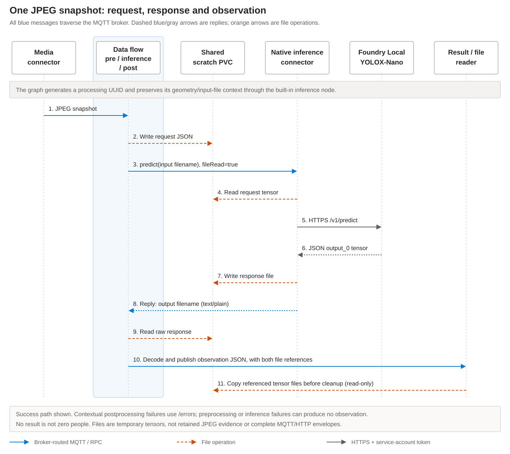

# Architecture and data contracts

The [person-detection scenario](../README.md) uses one continuous processing
pipeline. A new attempt starts when the graph receives a JPEG sampled by the
media connector. For environment configuration and resource deployment, see the
[deployment guide](deployment.md).

## Request sequence



All MQTT messages, including inference RPC requests and replies, traverse the
broker. The sequence omits a separate broker lifeline for readability.

1. The media connector publishes JPEG bytes with QoS 1, no retain, and a
   30-second message TTL. It samples at 0.2 snapshots/sec.
2. Preprocessing generates a UUID and processing-start time, decodes the JPEG,
   and writes a prepared input file to the graph's `person-inputs` store.
3. The next node receives the **plain filename bytes**, with `application/json`
   content type. Image geometry, settings, UUID, and input filename travel in the
   reserved `edge-predictive-inference/context` MQTT user property.
4. The built-in inference transform invokes the native connector's `predict`
   command with `read_request_from_disk=true`.
5. The connector reads the input file, calls the configured Foundry endpoint's
   `/v1/predict` API over HTTPS/SAT, and receives the model result.
6. With `write-response-to-disk=true`, it writes a response file and returns that
   filename as bytes with `text/plain` content type.
7. Postprocessing validates the preserved context and filename, reads the
   response, decodes person detections, and removes the internal context property.
8. The graph publishes observation JSON to `results`, or a contextual
   postprocessing error to `errors`.

The external topic prefix is configurable. The postprocessing module sets the
message's output topic to `results` or `errors`; the ARM destination template
`<topicPrefix>/${outputTopic}` expands it to the final MQTT topic.

## Model and tensors

The model is the checksum-pinned, unmodified `yolox_nano.onnx` from the upstream
YOLOX `0.1.1rc0` release:

```text
SHA-256: c789161ed43c8269fcd4e67c67eeeb4e80c622da2eb296a20bc6007bd18a0b7d
Input:   images, FP32 [1,3,416,416]
Output:  output, FP32 [1,3549,85]
```

Foundry's response item exposes the tensor as `output_0`. The sample checks that
name and shape rather than guessing how to interpret an arbitrary model.

### Preprocessing

The Rust implementation:

- Decodes only JPEG, with an 8 MiB payload limit and 4096-pixel dimension limits.
- Uses the smaller of `416 / width` and `416 / height` as its resize ratio.
- Resizes with the `image` crate's Triangle filter, preserving aspect ratio.
- Places the image at the top-left of a 416 x 416 canvas; bottom/right padding is
  `114`.
- Arranges channels in **BGR**, channel-first order, as FP32 values in `[0,255]`.
- Serializes a nested JSON array with shape `[1,3,416,416]`.

There is **no** division by 255, RGB ImageNet normalization, or second JPEG
preprocessing pass in Foundry. The connector submits prepared JSON tensors, not
images. This differs from a pipeline that sends JPEGs to the model server's image
API. Triangle resizing is not a claim of bitwise equivalence to OpenCV
`INTER_LINEAR`; qualify accuracy with the target implementation.

### Postprocessing

Each of the 3549 rows contains four raw box values, objectness, and 80 COCO class
probabilities. The decoder uses stride grids 8, 16, and 32. It:

1. Checks the complete tensor shape, finite values, and probability ranges.
2. Computes `objectness * person_probability` for COCO class 0.
3. Applies `scoreThreshold`, default `0.30`.
4. Decodes the raw grid/size values and maps boxes to original-image pixels.
5. Clips boxes to image bounds and performs nonmaximum suppression with
   `nmsThreshold`, default `0.45` IoU.
6. Returns at most 100 person detections. `detectionLimitReached` indicates that
   the cap was reached; do not interpret a capped count as total occupancy.

Other COCO classes are not published. A different detection task requires a
suitable model and matching preprocessing/postprocessing, as described in
[adapting the scenario](#adapting-the-scenario).

## Shared-file contract

All consumers mount the **same claim in `azure-iot-operations`**:

| Consumer | Access | Relative directory |
| --- | --- | --- |
| Preprocessing WASM | Writes through `person-inputs`. | `edge-predictive-inference/inputs` |
| Inference connector | Reads requests at `/data/<directory>`. | `edge-predictive-inference/inputs` |
| Inference connector | Writes responses at `/data/<directory>`. | `edge-predictive-inference/responses` |
| Postprocessing WASM | Reads through read-only `person-responses`. | `edge-predictive-inference/responses` |
| Reader pod | Mounts the claim read-only at `/data`. | Both directories. |
| Cleanup job | Deletes aged files only in these directories. | Both directories. |

The model server does **not** mount this claim. The connector sends the actual
tensor data over HTTPS; it does not send the model server an inaccessible local
filename.

Requests are named `<frameId>.json`. Responses have connector-generated names,
normally UUIDs without extensions. Both references are included in observations.
The application accepts only single safe relative filenames, never absolute
paths, nested paths, or `..`.

The claim is scratch storage. The original JPEG, complete RPC/HTTP envelopes,
and final observation history are **not** retained on it. The model is stored and
loaded by Foundry separately. The graph's `requestDiskPersistence: Disabled`
does not disable its explicitly configured file stores.

## Correlation and delivery

The internal frame context ties image geometry, model/camera settings,
processing-start time, and input file to one processing attempt. Source messages
containing the reserved property are rejected. Duplicate/invalid contexts and
inconsistent preprocessing/postprocessing settings are rejected.

The built-in graph preserves the message's user properties and timestamp.
Postprocessing removes only the sample's reserved property, retains other
metadata, replaces the payload with JSON, and changes the output topic suffix.

`processingStartedAtUnixMs` and `processedAtUnixMs` are processing timestamps.
They are not RTSP presentation timestamps, capture timestamps, or proof of
alignment with a machine event. No synchronization, tracking, pose reasoning,
business-event deduplication, durable outbox, or exactly-once delivery is provided.
A duplicate JPEG delivery can generate a different processing UUID.

## Failure behavior

| Failure | Observable behavior |
| --- | --- |
| Invalid/oversized JPEG, input write failure, or invalid source metadata | Preprocessing logs an error and fails the operation. No successful observation is emitted. |
| Inference RPC timeout, model/authentication failure, or connector I/O failure | The built-in transform logs the failure and drops that message. It does not emit a synthetic observation or a sample `/errors` message. |
| Missing/invalid internal context or mismatched stage settings | Postprocessing logs and fails the operation. |
| Wrong response content type/reference, missing response file, invalid model tensor, or decode failure with valid context | Postprocessing publishes `status: "error"` under `/errors`, with frame identity, the request reference, and the response reference when valid. No person count or detection list is included. |
| Valid inference with no qualifying detections | Publishes `status: "ok"`, zero count, and an empty list under `/results`. |

Silence is **not** a negative detection. Consumers must monitor result freshness,
camera availability, graph/connector logs, storage capacity, and timeout metrics
separately. Do not use the existence of an `/errors` topic as evidence that every
failed frame produces an error message.

For example, the postprocessing error portion of an observation is:

```json
{
  "status": "error",
  "error": {
    "stage": "postprocess",
    "message": "Expected one [1,3549,85] output_0 tensor"
  }
}
```

The actual error observation also carries the common identity, timing, image,
and available file-reference fields. This excerpt is not a complete payload.

## Compatibility

| Component | Selected contract |
| --- | --- |
| Native connector | `mcr.microsoft.com/azureiotoperations/inference-connector:0.1.2` |
| Microsoft inference graph | `azureiotoperations/graph-dataflow-inference:0.2.0-preview.0` |
| Graph digest | `sha256:4a3ca352ad900e459785674c3a2648c9b5a1f73583e8dbdb73c653471704c52d` |
| Microsoft's referenced inference module | `azureiotoperations/module-inference-engine:0.2.0` |
| Custom WASM SDK | `wasm_graph_sdk = 1.7.4`, preview Cargo feed; Rust 1.90 / WASI Preview 2. |
| Custom graph requirements | Graph API `1.7.2`, runtime `1.1.8`, graph schema `1.1.0`. |
| AIO ARM resources | `2026-09-03-preview` with AIO Apps and graph file stores. |
| ADR resources | `2026-04-01` namespaced devices/assets. |

The selected inference graph returns **plain output-filename bytes**. A newer
graph that returns an input/output JSON envelope is not a drop-in replacement.
The postprocessing module deliberately rejects an incompatible content type or
reference rather than producing a misleading zero-person result.

These are component contracts, not a guarantee that every AIO preview release
supports their combination. Confirm capability availability in the target
environment and qualify it before use.

## Adapting the scenario

Changing the camera URL, secret references, topic prefix, camera/model resource
names, or thresholds requires configuration changes and redeployment, not Rust
changes. Changing a running artifact should use a new `artifactVersion`.

A different model family, image normalization, tensor layout, output name/shape,
or class set requires changes to preparation/decoding and corresponding tests.
Update model provenance and qualification; do not merely rename YOLOX-Nano.

To fan out one JPEG source to additional models, use separate graph instances
and result topics, configure their models on the **existing** inference connector,
and explicitly separate their context/store contracts. Shared input does not imply
frame-joined results. This scenario configures one model on one connector.
